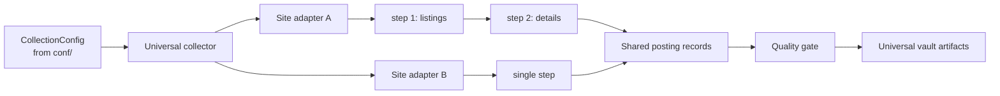

# Collection steps and the universal collector

Status: decided 2026-11-16. Steps are adapter-defined and lightweight; chunks
are the unit of resume. More sites are expected soon, so adding one adapter must
not touch the collector.

The current model assumes one `gather_data` call per site. That does not cover
the intended range: some sites return complete postings in one response, some
need a listing pass and then detail pages, some can supply extra data such as a
company list, and some steps should be skippable on a given run.

## Concepts

| Concept | Responsibility |
| --- | --- |
| **Site adapter** | One source's knowledge: how to fetch, how to parse, which steps exist and in what order. |
| **Step** | One named operation on the shared record set, defined by the adapter. Often two (listing, then details); sometimes one. |
| **Universal collector** | Runs adapters over query units, merges results, applies quality gates and stores the universal vault. |
| **Data spec** | Declares the fields a step requires and produces ([specs.md](specs.md)). |

The adapter knows the site. The collector knows the run. Neither contains the
other's logic.



Step names are not fixed. `listings`/`details`, `search`/`fetch`, or `all` are
all valid; the adapter module documents what its steps do.

## Adapter and step contract

Sketch, not a final signature:

```python
@dataclass(frozen=True)
class Step:
    name: str
    run: Callable[[dict, CollectionConfig], dict]
    input_spec: DataSpec | None = None
    output_spec: DataSpec | None = None


class SiteAdapter(Protocol):
    source: str
    steps: tuple[Step, ...]      # declared order; one or two in practice


def LISTINGS(records, config): ...
def DETAILS(records, config): ...


class KarriereAT:
    source = "karriere.at"
    steps = (Step("listings", LISTINGS), Step("details", DETAILS))
```

The site class is both the adapter and the owner of its steps; it inherits
`BaseScraper` only for the run context (config, dates), not for an algorithm to
override (Q30). Steps are usually bound methods declared in `__init__`, so
per-run state such as cookies is available without a base hook.

The `Step` dataclass is a convenience, not a framework. An adapter that prefers
two plain functions and a tuple can expose `steps = (("listings", LISTINGS),
("details", DETAILS))`; the collector only needs ordered `(name, callable)`
pairs. Do not add a required/optional flag, a registry base class or a validation
hierarchy now. The collector calls the callable with `(records, config)` and
rebinds the result.

An adapter may expose one step (single-shot site) or several. A typical
two-step site does a listing pass that fills identity and URL, then a detail
pass that fills description and salary. A site that returns everything in one
response has one step. Step names are the adapter's business.

Adding a site: create `scrapers/websites/<site>.py`, define the adapter and its
steps, add one registration entry. No collector, data or profile change. This is
the requirement that the growing site list will test.

## Execution rules

1. **Order.** Steps run in the adapter's declared order. The collector may skip
   steps, not reorder them.
2. **Skip.** `CollectionConfig.steps` selects which steps run. Empty means every
   adapter's default list. Any step can be skipped, including the expensive
   detail step, if the resulting data is still acceptable to the next stage.
3. **Shared records.** Every step works on the same dict of postings keyed by
   identity. A step enriches fields or adds records; it does not create a second
   record shape.
4. **Return, do not mutate.** A step returns a new dict; the caller rebinds
   `records = step.run(records, config)` (Q22).
5. **Specs at boundaries.** Before a step: records satisfy its input spec, when
   declared. After: the result satisfies its output spec. Unknown extra fields
   are always allowed.
6. **Failure.** An exception from a step is recorded in the run report. Later
   steps may still run if they do not depend on the failed step's fields; the
   collector does not abort the whole run for one site. A failed step is never
   reported as an empty success.
7. **Minimum viable run.** The configured steps must run without error. No
   per-adapter required-step declarations; there is no partial-success policy
   beyond "record what failed" (Q23).
8. **Zero records.** A unit that returns no records at all is a failed
   acquisition. A later step that returns records from a non-empty input is a
   normal result.
9. **Idempotency.** Rerunning a step replaces the fields it produces. It does not
   duplicate records or append provenance twice.
10. **Scope.** The collector merges unit results and deduplicates by identity;
    steps do not coordinate with each other across sites.

Cache inputs (`cached_postings`, `cache_hit_predicate`) travel in the config,
not in the record set, so a `details` step can skip work for reusable IDs
without adding a marker field. They are data, not scope: `scope_digest()` does
not include them (B22, [specs.md](specs.md#collectionconfig)).

Failures are visible in the JSON run report and in the pipeline's exit status.
Silence is reserved for a genuinely empty but valid response.

## Side outputs

A side output (a company list, for example) is not a pipeline dataset. It is an
export or a BI view derived from the collected records when someone needs it
(Q18). Do not add a `companies` dataset, a separate step artifact or a side
speculative pipeline. If a real side dataset becomes a requirement, it gets its
own spec and artifact then.

## Scenarios

| Site shape | Steps | Notes |
| --- | --- | --- |
| API returns full postings | `all` | One step. |
| Listing + detail pages | `listings` → `details` | Listings usable alone; details fill description and salary. |
| Listing + detail + extra extraction | `listings` → `details` → `salary` | Later steps optional by configuration; failures recorded. |
| Coverage run without details | `listings` only | Partial records; downstream checks its input spec. |

The "main step can be omitted" case is just step selection: the collector
produces what the chosen steps produce, and the next stage checks whether its
input spec is satisfied. There is no special partial-run mode.

## Universal collector

The universal collector is the only place that:

- iterates adapters and their declared steps (an adapter's `listings` step owns
  its own query × location units until steps take a unit argument),
- applies step selection,
- merges unit results and deduplicates by identity,
- records step outcomes, and writes chunks plus the run report (M4),
- writes universal artifacts and the scope digest *through the pipeline* in M4.

It lives at `acquisition/collector.py` with `run_collection` as the entry point
(Q26). Today `pipelines/scrape_universal.py::run_universal_scrape_flow` is the
closest equivalent. The refactoring should name and isolate that role rather than
leaving it inside a function that also handles caching and quality details.

M4 keeps the quality gate and vault storage in the pipeline: B21 moves the gate
to `acquisition/quality.py`, and B24 calls it around `run_collection`. The
collector therefore writes only its own artifacts (chunks, run report) and
returns `{"records", "report"}`. Stage extraction (B36) may later pull the gate
into the collection stage; that is a change of caller, not of the collector.

The collector does not know site mechanics and does not contain profile rules.
It does know how to call an adapter's steps in order and how to record what
happened.

## What changes in the current code

- `BaseScraper.gather_data` and the `process` flag become step selection: an
  adapter declares steps, and the collector decides which run.
- `BaseScraper` keeps only run context: config normalization, `time`/`day`/
  `business_day`, `source` and `steps`. It keeps no page-loading or parsing
  helpers for sites to override; those live in `http`, `browser`, `pagination`
  and `parsing`, and per-site differences are arguments or `rules` keys (Q30).
  Exactly one `BaseScraper` survives.
- `scrapers/scrape.py` splits into HTTP and headless-browser paths
  (`scrapers/http.py`, `scrapers/browser.py`), with pagination shared (Q2).
  `scrape.py` stays as a facade during migration.
- `scrape_sites` becomes the collector loop over adapters and units.
- Quality gates move next to the collector, not inside a scraper.
- Enrichment steps that extract salary, language or company facts are explicit
  steps only when they need the raw page; otherwise they run later on saved
  facts.
- The duplicate site modules are collapsed; adding a new site is one module plus
  registration.

## Still open

- Q16 compatibility layer for `scrapers.sites` and `collecting.get_postings`.
  See [open-questions.md](open-questions.md#still-open).

Retries and backoff stay inside a step's mechanics for now; the collector only
records failures.
