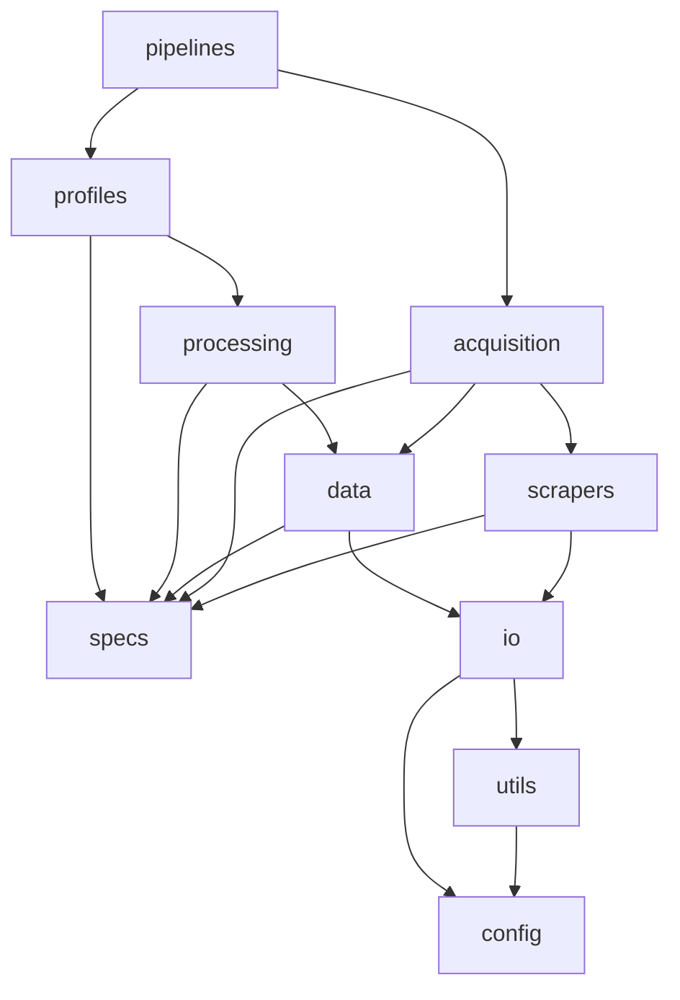

# Module seams

Status: decided 2026-11-16 for grouping and mechanics split. This document
names the parts that can be separated today, the parts that should stay
together, and the import directions that keep the separation real. It is the
"true separations" direction in concrete form.

Three new modules are added: `specs/`, `acquisition/` and `data/` (Q1). The
mechanics file splits into HTTP and headless-browser paths (Q2). More sites are
coming, so a site must be addable without touching the collector (A14).

## Dependency rules



Allowed direction is upward only:

| Module | May import | Must not import |
| --- | --- | --- |
| `specs` | stdlib | anything in the package |
| `config` | stdlib | everything else |
| `utils` | `config` | everything else |
| `io` | `config`, `utils` | `specs`, `processing`, `profiles`, `scrapers`, `pipelines` |
| `scrapers` | `config`, `utils`, `io`, `specs` | `processing`, `profiles`, `pipelines` |
| `acquisition` | `config`, `io`, `scrapers`, `data`, `specs` | `profiles`, `pipelines` |
| `data` | `config`, `io`, `utils`, `specs` | `scrapers`, `acquisition`, `profiles`, `pipelines` |
| `processing` | `config`, `data`, `io`, `utils`, `specs` | `scrapers`, `acquisition`, `profiles`, `pipelines` |
| `profiles` | `config`, `processing`, `data`, `utils`, `specs` | `scrapers`, `acquisition`, `pipelines` |
| `pipelines` | everything | — |

`specs` is a leaf because a site adapter, a data operation and a profile
derivation must all agree on field names without importing each other.

`scrapers/http.py` and `scrapers/browser.py` have different dependencies and
failure modes. One `scrape.py` facade keeps call sites stable during the move;
the facade is removed when no caller needs it. Pagination is shared because both
paths construct the same query URLs.

Adding a site: one module under `scrapers/websites/` plus one entry in the
registry used by the collector. The adapter owns parsing, selectors and its step
list. No collector, data or profile edit. There is still no plugin framework;
the registry is an explicit list.

Paths: no absolute paths. `REPO_ROOT` is derived from `__file__` in one place
(see [open-questions.md](open-questions.md#no-absolute-paths)); every catalog or
config path is relative to it. Tests use relative paths or `tmp_path`.

### Current violations (verified 2026-11-16)

| Violation | Where | Why it matters |
| --- | --- | --- |
| `processing` → `pipelines` | `derive_profile_postings.py` imports `load_postings`, `merge_observations` from `pipelines.store_universal` | A lower layer depends on the composition layer; the data functions cannot be reused or tested alone. |
| `processing` → `profiles` | `derive_profile_postings.py` imports Dani constants and policy functions | Generic derivation is profile-specific; a second profile forces an edit here. |
| `processing` → `scrapers` | `postings_utils.py` imports `BaseScraper` inside `enrich_postings` | Re-enrichment pulls in Selenium, requests and scraper configuration. |
| Duplicate implementations | `scrapers/sites.py` vs `scrapers/basescraper.py` and `scrapers/websites/*` | Two copies of the same classes; callers and fixes can drift. Every new site would otherwise start as another copy. |
| Absolute path | `config/configs.py` hardcodes an absolute Windows repository root (`REPO_ROOT_PATH`) | The package only works on one machine and leaks a local path into config. Replace with a root derived from `__file__`. |
| Empty modules | `processing/candidate_filtering.py`, `selection_filtering.py`, `scoring.py` | Names promise behaviour that does not exist; delete them and let profile functions plus `processing/scoring_mechanics.py` own the roles (Q15). |
| Stale module | `schedule/hardverapro_collect.py` imports a missing module | Archive-only one-off; not a migration gate (Q17). |

## Target package map

Proposed names. Renames are cheap; ownership is the point.

```text
src/jobscraping/
  specs/
    base.py               # FieldSpec, DataSpec, check
    postings.py           # DataSpec constants: discovered, collected, universal, scored
    companies.py          # only when a real side export exists
  config/
    constants.py          # filenames, column layout, request constants
    models.py             # CollectionConfig, ProfileConfig (YAML-backed)
    configs.py            # split later; keep during migration
  utils/
    urls.py
    datastruct_utils.py
  io/
    files_io.py           # JSON load/save, listing, filename selection
    outputs_excel.py      # Excel rendering and cleaning
    outputs.py            # Markdown/email + current compatibility caller
    generate_profile_outputs.py
  scrapers/
    scrape.py             # facade during the split
    http.py               # requests path
    browser.py            # Selenium session, popups, scrolling
    pagination.py         # URL construction and next-page rules
    parsing.py            # payload -> neutral facts
    steps.py              # optional Step convenience, no enforcement
    basescraper.py        # shared orchestration only; one copy
    websites/
      __init__.py         # public exports + registry
      karriere_at.py      # adapter + its declared steps
      raiffeisen.py
      <next_site>.py      # one module per new site
  acquisition/
    collector.py          # run_collection: adapters, units, steps, merge
    quality.py            # validate_postings_quality and gates
    chunks.py             # chunk naming, save, load, resume
  data/
    load.py               # persistence wrapper, relative paths, atomic write
    merge.py              # merge_observations, history rebuild
    compare.py            # neutral added/removed diff
    enrich.py             # rerunnable generic enrichment
  processing/
    facts.py              # factual_postings and normalization
    language.py           # text language + requirement evidence
    scoring_mechanics.py  # scoring mechanics, profile-agnostic
    derive.py             # generic profile derivation
  profiles/
    dani.py               # policy functions and config defaults
  pipelines/
    collection.py
    derivation.py
    outputs.py
    cli.py
```

## Current → target mapping

| Current | Target | Reason |
| --- | --- | --- |
| `scrapers/sites.py` (`BaseScraper` + sites, 974 lines) | `scrapers/basescraper.py`, `scrapers/websites/*` | Active copy plus duplicated copies elsewhere; one owner per class. |
| `scrapers/scrape.py` (659 lines) | `http.py`, `browser.py`, `pagination.py` behind a `scrape.py` facade | HTTP and browser have different dependencies and failure modes. |
| `BaseScraper.gather_data` + `process` flag | adapter steps + `scrapers/steps.py` + collector selection | Sites differ in how many requests and which data they can supply; one flag cannot express that. |
| `BaseScraper._process_data` chain | `processing/` + `profiles/` | Profile processing is not scraper mechanics. |
| `processing/postings_utils.py` (514 lines) | `data/merge.py`, `data/compare.py`, `data/enrich.py`, `processing/facts.py` | Historical mix of pure data, enrichment and a scraper import. |
| `pipelines/store_universal.py` | `data/load.py`, `data/merge.py`, `acquisition/collector.py` + thin pipeline | Storage and merge are pure; scope and orchestration belong to the collector. |
| `pipelines/scrape_universal.py::run_universal_scrape_flow` | `acquisition/collector.py` + pipeline | One function owns scope, cache, acquisition, quality and storage. |
| `pipelines/collecting.py` helpers | `acquisition/collector.py`, `acquisition/quality.py` | Reusable acquisition sits inside the legacy pipeline. |
| `processing/derive_profile_postings.py` | `processing/derive.py` + profile policy functions | Generic derivation with a policy input; no wrapper class. |
| `processing/attributes.py` | `processing/language.py`, `processing/scoring_mechanics.py`, `data/enrich.py` | Detection, scoring and enrichment are different reasons to change. |
| `config/configs.py` | `config/models.py`, `config/constants.py`, `specs/`, `conf/` | Config values, code constants and data-spec field names are three different things. |

## Seams deliberately not made

- **Posting records stay dicts.** JSON export implies dicts; a `Posting`
  dataclass would force a full schema on heterogeneous optional fields. Data
  specs validate the fields we rely on, and unknown keys are preserved.
- **No per-dataclass decomposition.** `ArtifactPaths`, `QualityPolicy`,
  `ScoringConfig` and similar wrappers are dropped; see
  [specs.md](specs.md).
- **No storage repository abstraction.** `files_io` is enough until a second
  backend has a consumer.
- **Excel rendering and its cleaning helpers stay together.** They change for
  the same reason.
- **`BaseScraper` stays a class.** Site adapters share lifecycle and hooks; a
  function-only design would reintroduce parameter passing.
- **No plugin/discovery system for sites.** Adding a site is one module and one
  registry entry; the registry is an explicit list, not a framework.
- **No `ProfilePolicy` wrapper.** Profile functions and `ProfileConfig` are
  passed to the generic derivation directly (Q5).
- **No scoring class.** Scoring stays values plus the shared mechanics (Q4).
- **No absolute paths.** Paths come from a runtime-derived repository root; no
  module stores a machine-specific root.

## Seam test

Before creating a module, answer:

1. Can it be imported without a browser, a network call or a profile module?
2. Does it have one reason to change, and can that reason be named?
3. Can it run from saved artifacts or a small fixture alone?
4. Does its test avoid another part's fixtures?
5. Is there exactly one kind of caller (or one pipeline) that needs it?

A "no" is a reason to keep the code where it is until the seam is real.

## Migration notes

- Add `specs/` and the step contract before moving site bodies: the contract is
  what the moved code must satisfy.
- Collapse the duplicate scrapers before adding more sites. Otherwise every new
  site multiplies the duplication.
- Move the classes first, then split the mechanics file; splitting both at once
  makes parity unverifiable. HTTP and browser split is the target, not a
  prerequisite for moving site bodies.
- Keep `scrape.py` as a facade re-exporting moved helpers so call sites do not
  change during the move.
- Keep `config/configs.py` in place during migration; derive the root from
  `__file__` there first, so every path becomes relative before anything moves.
- Delete the three empty processing modules when derivation owns the roles; do
  not rename them into permanent placeholders.
- The target tree is not a license to rename everything: renames must pay for
  themselves in clarity or remove a duplicate.
