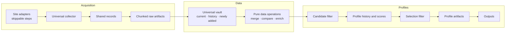

# Refactoring plan

Status: decisions recorded, 2026-11-16. Target architecture is decided. Nothing
here authorizes a runtime migration yet; moves that are already implemented are
marked as such.

This is the top of the ladder. It states what we want and in what order.
[Breakdown](breakdown/README.md) turns each phase into workstreams.
[Design](design/README.md) holds the concrete module maps, data contracts and
Kedro layout. [Backlog](backlog.md) is the ordered task list with dependencies
and done criteria. [Process map](process_map.md) is the long-form 2026-11-02
sequencing reference this plan inherits from.

## What "refactoring" means here

The runtime still works through the legacy profile flow:
`schedule/*_collect.py` → `pipelines.collecting.get_postings`, which scrapes,
processes, compares and stores per profile. The modular pieces exist around it:
`pipelines/scrape_universal.py`, `store_universal.py`,
`processing/derive_profile_postings.py` and `profiles/dani.py` are wired for
Dani only. The refactoring is the move from that state to a set of parts that
can be run, tested and replaced independently.

## Goals

1. **Separate what can be separated.** Each part has one reason to change:
   site mechanics, HTML parsing, acquisition orchestration, generic data
   operations, profile policy, output rendering, pipeline composition.
2. **Mark each real separation with a data spec.** Each step declares the fields
   it needs and produces, so a part can be started from saved data in practice,
   not only imported.
3. **One implementation per behaviour.** Remove the duplicated scraper classes
   and the legacy/universal overlap instead of maintaining two copies.
4. **Profile-neutral, unfiltered collection.** The universal vault stores every
   posting the queries returned; no profile score, threshold, language
   exclusion, manager or role filter leaks into raw data. Profiles filter.
5. **Resumable, verifiable runs.** Every stage reads named artifacts and writes
   named artifacts; a failed run cannot silently replace a healthy snapshot.
6. **Kedro as the pipeline runtime.** Pipelines, `conf/`, parameters and
   catalog become the composition layer; ad-hoc scripts become thin entry
   points or disappear. The Kedro graph is built by the user, starting with
   collection and storing.
7. **Keep behaviour while moving it.** Existing scoring, selection and output
   rules are preserved unless a change is explicitly decided.
8. **Cheap new sites.** More sites are coming soon. Adding one is one adapter
   module plus registration; the collector, data layer and profiles do not
   change.

## Non-goals (this round)

- No new sites inside the refactor. More sites are planned, so the design must
  make them cheap, but adding one is a separate change.
- No scraper for the historical leads (LinkedIn, HiringCafe).
- No new scoring model, no threshold tuning beyond what a profile migration
  already agreed.
- No universal backfill written to live data without a reviewed dry run.
- No rewrite of request mechanics, Selenium handling or regex libraries as part
  of a structural move.
- No redesign of the open-source package scope (PDF/DOCX, alternative storage
  backends) before a consumer exists.

## Principles

- **Move before improve.** Relocate behaviour unchanged, prove parity, then
  change it. A move that alters behaviour needs its own completion check.
- **Separate on evidence, not aesthetics.** A seam earns its place when two
  callers use the parts differently, one part has an external dependency the
  other does not, or the parts have different change reasons.
- **Specs at boundaries, dicts for records.** Each step has a data spec for the
  fields processing relies on; posting records stay plain dicts (JSON,
  heterogeneous optional fields, unknown keys allowed). Dataclasses are limited
  to data specs and YAML-backed config. See [design/specs.md](design/specs.md).
- **One direction of dependency.** `pipelines` may depend on everything below
  it; `processing` and `data` must not import `scrapers`. See
  [design/module-seams.md](design/module-seams.md).
- **Artifacts are the interface.** A stage is defined by its named inputs and
  outputs, not by the objects it happens to pass in memory.
- **No absolute paths.** The repository root is derived from `__file__` in one
  place; every configured path is relative to it. Tests use relative paths or
  `tmp_path`.
- **One module per site.** The adapter owns selectors, parsing and its ordered
  step list; the collector owns the loop. Adding a site does not edit shared
  code.
- **No second source of truth for configuration.** Code-level constants stay in
  `config/`; run-tunable values move to Kedro parameters when Kedro lands.

## Target shape



The boundary that matters most is between the universal vault and a profile.
Profiles own relevance; the vault owns existence, provenance, dates and generic
facts. The universal collector is the only part that runs site adapters across
query units and writes the vault. Kedro sits above this as composition (nodes
and flows), not as a new layer of business logic.

```text
src/jobscraping/
  specs/              # data specs per step
  acquisition/        # collector, quality gates, chunks
  data/               # pure merge, compare, enrich, history
  io/                 # files, Excel, Markdown, email
  pipelines/          # Kedro flows and thin entry points
  processing/         # generic facts, language, scoring mechanics
  profiles/           # per-profile policy and configuration
  scrapers/           # HTTP/browser mechanics, parsing, site adapters
```

Names and grouping are proposals; the reasoning is in
[design/module-seams.md](design/module-seams.md).

## Phases

Each phase ends with something verifiable and leaves the runtime working. The
task-level order, dependencies and done criteria are in
[backlog.md](backlog.md).

### Phase 0 — Baseline and guardrails

Fingerprint what is live: entry points, imports, saved-data layout, tests.
Locate every absolute path and hardcoded machine root, starting with
`REPO_ROOT_PATH` in `config/configs.py`, and record how each becomes relative.
Add fixture-based tests for the behaviour that the move must preserve (merge,
compare, language assessment, selection). Confirm the current test command.

**Verify:** documented baseline; the new tests fail on a deliberately broken
merge and pass on current code; no design or code sample in this topic contains
an absolute path.

### Phase 1 — Collapse duplicates and establish seams

One `BaseScraper`, one implementation per site, one owner of shared parsing and
mechanisms. Split the mechanics file into HTTP and headless-browser paths behind
a facade. Define the adapter step contract: each adapter declares its ordered
steps (one or two in practice) with data specs; the collector selects steps. No
required/optional flags.

Create `specs/` and fill the five posting specs. Extract acquisition helpers
(`scrape_sites`, `validate_postings_quality`) out of the legacy `collecting.py`
and create `acquisition/` around the collector. Remove the `processing` →
`scrapers` import. Hardverapro is archive-only and not a gate.

**Verify:** only public scraper imports remain; a fixture page per site still
parses to the same facts; no duplicated class bodies; adding a test site means
one module plus one registration entry; a listing-only run yields a valid
partial result that later stages accept or reject explicitly.

### Phase 2 — Pure data operations

Move merge, comparison, history rebuild and generic enrichment into a layer that
runs without scraping or profile knowledge. Settle conflict rules (dates,
description freshness, scalar fields) and keep profile fields out. The universal
vault stores all postings; no role or manager filtering happens here. Old profile
points are dropped from universal records (plan only; live data is not migrated).

**Verify:** deterministic fixtures: repeated merges are idempotent, earliest and
latest dates survive, reruns produce byte-identical JSON; a universal record
contains no profile field; writes are atomic and timestamps are UTC.

### Phase 3 — Profile policy seam

Make derivation generic and put profile-specific behaviour in `profiles/`
(candidate rule, scoring, selection, language policy, output configuration).
There is no `ProfilePolicy` wrapper and no scoring class: config values plus
plain functions. Delete the three empty modules (`candidate_filtering.py`,
`selection_filtering.py`, `scoring.py`) and keep the roles in `processing/` and
the profile module. A profile `current_postings.json` holds selected postings
only. Dani is the reference migration; other profiles stay on the legacy path
until deliberately converted.

**Verify:** Dani derives from saved universal facts without scraping; its
current/newly-added behaviour matches the agreed delta rules; the derivation
module contains no profile constants.

### Phase 4 — Stage orchestration and artifacts

Give every stage a named input, named output and failure behaviour. Add data
spec checks at stage boundaries, chunk layout, resume, UTC timestamps, a
`schema_version` on vault artifacts, atomic writes and a JSON run report. Stage
functions become the unit that Kedro will compose.

**Verify:** interrupt and resume reproduce the same vault as an uninterrupted
run; a failed quality gate leaves the previous snapshot intact and writes one
incomplete-run artifact; a stage started from saved data reports missing required
fields before running; no artifact write truncates an existing file on failure.

### Phase 5 — Kedro adoption

Add `conf/`, a catalog, parameters, `settings.py`, `pipeline_registry.py` and
node wrappers around the stage functions. The user builds this graph, starting
with collection and storing rather than a universal pipeline. Keep `schedule/`
entry points until the Kedro pipelines reproduce them, then retire the
duplicates. No catalog path is absolute; machine-specific values stay in
`conf/local/`.

**Verify:** `kedro run` reproduces the same artifacts as the script path for one
full collection and one derivation; parameters come only from `conf/`; no
machine paths or profile thresholds remain hardcoded in pipeline modules.

### Phase 6 — Cleanup and documentation

Remove superseded modules, compatibility adapters without callers, empty
skeletons and the experimental pipeline. Update runtime documentation, the
glossary and the ADR set. Keep historical analysis clearly labelled.

**Verify:** imports and tests pass; the documented entry points are the only
entry points; no module is imported solely for backwards compatibility.

## Overall success criteria

- A new contributor can run collection, derivation and outputs by reading
  `conf/` and one pipeline module, without opening a scraper.
- Any stage can be started from its saved artifacts, because its data spec
  validates the input first.
- Adding a site is one adapter module plus one registration entry.
- Profile policy can be changed without touching acquisition or storage.
- One implementation per behaviour, one owner per artifact.
- No committed absolute path; the project runs from a fresh clone.
- The behaviour of existing profiles is unchanged where no decision said
  otherwise.

## Risks

- **Two runtimes during migration.** Legacy scripts and the Dani path drift.
  Mitigation: explicit ownership per artifact and a written cutover per profile.
- **Kedro adoption too early.** Nodes wrapping impure functions reproduce the
  tangle in YAML. Mitigation: Phase 4 before Phase 5.
- **Raw archive treated as spec.** The 2026-11-02 material contains stale claims
  (for example, deleted files that exist here). Mitigation: every raw claim is
  re-checked against the working tree before implementation.
- **Data loss during backfill.** Mitigation: dry-run artifacts, no in-place
  replacement, atomic writes.
- **Machine-bound paths.** A hardcoded root or catalog path makes the project
  work on one computer only. Mitigation: derive the root from `__file__`, keep
  every path relative, and fail fast on an absolute path in tracked config.
- **Site growth.** The site list expands soon. If adding one still means
  copying `BaseScraper`, the refactoring failed its main test. Mitigation: one
  adapter module plus registration, enforced by a test that adds a sample site.

## Decisions still open

Only the compatibility layer (Q16) remains open; everything else is recorded in
[design/open-questions.md](design/open-questions.md#resolved-questions).
