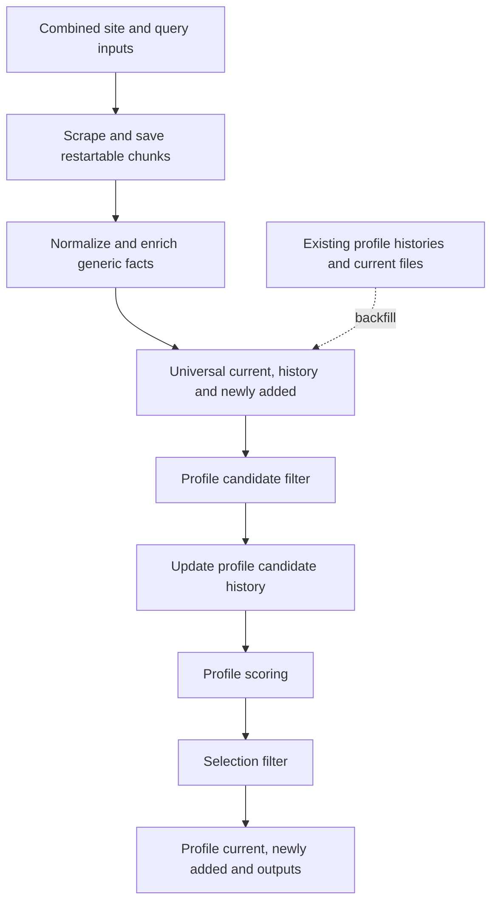

# Restructuring process map

Collected: 2026-11-02. This is a working map of work to discuss and complete,
not approval to implement every historical proposal. The 2026-11-16 decisions in
[design/open-questions.md](design/open-questions.md) supersede any conflicting
detail here, including step names and granularity.

Detailed source material from both repositories is indexed in
[the raw archive](raw/restructuring-2026-11-02/README.md), with full snapshots and
source hashes. `notes/refactoring/raw/` is Git-ignored and local only; this map can be tracked.
Source names below refer to that archive. Older paths, status claims and counts
need checking before use.

The [reference index](raw/restructuring-2026-11-02/README.md) records the six
distinct references retained from the second folder and links to material already
present in main. Redundant copies and obsolete data snapshots are excluded.
Decision: maintain this main repository; revisit the restructuring branch here
later rather than maintaining a second working copy.

Confirmed 2026-11-03: collection retains postings returned by configured searches
without title, seniority, language or relevance-score exclusions. Profiles own
candidate filtering, scoring and final selection. See the
[ownership decision](../../docs/adr/0001-collection-and-profile-ownership.md) and
[glossary](../../GLOSSARY.md). Search coverage and acquisition/data-quality failures
remain separate concerns.

Confirmed transition: Dani is the first consumer of separated raw collection and
profile evaluation. Other scripts temporarily retain their current behavior until
deliberately migrated. This establishes the intended boundary for Dani without
requiring universal backfill or every profile's migration first. The target remains
collection without relevance filtering throughout. The
[language and Dani plan](../language_correction_plan.md) records the confirmed policy
categories, topic scope and agreed language values, including the +0.35 English
bonus. Preserve Dani's existing history-based newly-added logic. Implementation
details remain visible proposals; the design discussion is complete and runtime
implementation is pending.

## Starting point

- Observed here: `src/jobscraping/` and `pyproject.toml` already exist; profile
  collection uses `pipelines/collecting.py`. This is not a package-from-scratch task.
- Observed here: universal scraping/storage and profile derivation modules are
  planning skeletons. Their presence does not mean those stages work.
- Observed in both folders: the combined `scrapers/sites.py` and split scraper
  files coexist. The older migration inventory's deleted-file claim is stale.
- Observed here: collection has cache support and incremental-collection tests.
  The old TODO's caching request is partly addressed; review what remains.
- Historical direction: collect once into a profile-neutral universal store, then
  derive tech/legal/dani/tn datasets. Confirm the details before implementation.
- Scope today: collect plans and map the work. No runtime migration is performed.

## Proposed data flow

The proposed universal layer owns identity, source, URLs, descriptions, salary,
language, collection dates and scrape-query provenance. Profiles own relevance,
scores, profile keywords, selection rules and outputs. Candidate history retains
broad matches even when they fail final selection. Whether generic enrichment
runs before or after the first universal save remains open.

## Work and dependencies

Unchecked items are pending design or implementation work, including work that
may already be partly present. The order below is a proposed dependency order.

1. [ ] **Establish scope and the baseline.** The implementation home is this main
   repository; the second working copy is being retired. Decide what current
   consumers need to keep running when restructuring resumes.
   Inventory current imports, scripts, local profile configuration, saved data,
   and existing tests in that repository. Keep the AWS course analysis historical.
   Completion check: a current baseline and explicit scope, without treating
   sibling-folder state as interchangeable. Sources: briefing, migration inventory.

2. [ ] **Define stage inputs, outputs and ownership.** Settle the posting identity,
   generic/profile field boundary, query provenance, first/last-seen semantics,
   and what current/history/newly-added mean. Decide candidate versus selection
   rules, manual overrides, and which stages save restartable artifacts. Consider
   small data contracts only at useful boundaries. Completion check: an example
   posting and saved artifact for each stage, including one shared by two profiles.
   Sources: modular plan, processing discussion, data research notes.

3. [ ] **Settle scraper responsibilities and imports.** Separate site-specific
   collection, shared HTTP/browser mechanics, HTML parsing and generic extraction
   from profile filtering/scoring. Evaluate the proposed `process=False` seam,
   listing/detail split, HTTP/browser split and formal base class against actual
   callers. Choose public imports and wire the per-site modules in the chosen
   repository. Completion check: concrete scraper imports and representative
   fixture-based collection work; raw results contain no profile scores and retain
   titles that individual profiles reject.
   **Collection-staging note:** begin with two modules behind a clear seam:
   discovery collects lightweight listing facts (stable ID, title, company,
   locations, query provenance and comparable metadata), then enrichment takes
   those facts and obtains deeper job-detail facts such as descriptions. The
   discovery interface must remain useful on its own, so urgent runs may stop
   after discovery. Site adapters may vary internally, but callers should not
   need to know whether a site exposes one endpoint or separate listing/detail
   endpoints. Keep discovery coverage and enrichment completeness as separate
   quality signals. Do not introduce more stages until an actual site needs one.
   Sources: scraper split plan, migration inventory, TODO, scraper sketches.

4. [ ] **Make data operations independently usable.** Specify merge, comparison,
   enrichment and history rebuilding without scraping. Preserve earliest/latest
   dates, query matches and useful non-empty fields; settle conflicting scalar
   values and description freshness. Avoid carrying profile `points` defaults
   into universal data. Choose existing module groups or a separate data layer
   based on these operations. Completion check: deterministic merges and reruns
   on saved fixtures, with explicit conflict rules. Sources: data research notes,
   migration inventory, legacy snippets.

5. [ ] **Backfill the universal store from existing data.** Inventory tech/legal/
   dani/tn histories and current files; merge by stable identity. Decide whether
   old scores/keywords/query matches are omitted or retained as namespaced
   provenance. Build historical and current datasets separately: an old history
   record alone does not establish that a posting is active. Include manually
   added CV-automation jobs if still wanted. Completion check: dry-run counts,
   duplicates, conflicts and dates reviewed before writing replacement data.
   Depends on 2 and 4. Sources: data research notes, TODO.

6. [ ] **Implement universal collection and storage.** Combine/deduplicate broad
   queries across profiles; checkpoint each agreed site/query/location unit;
   resume and merge chunks; maintain universal current/history/newly-added data.
   Review existing caching before adding more. Define partial-failure behavior
   so incomplete collection cannot silently replace a healthy snapshot. Run
   collection-quality checks before profile relevance filters; a profile rejecting
   many postings must not count as acquisition failure.
   **Refactoring note:** Dani currently has a narrow KarriereAT compatibility
   rule: a 410 after a successful search page ends that query's pagination,
   while a first-page 410 remains an acquisition failure. When collection is
   refactored, prefer an explicit source-pagination outcome (first-page failure,
   terminal page, or partial acquisition) over the current `process=False`
   conditional. Revisit the legacy scraper's implicit stop-on-non-200 behavior
   and preserve its useful semantics through a shared, tested policy.
   Completion check: interrupt/resume and cached/uncached fixture runs preserve
   identity, provenance and dates without losing successful chunks.
   Depends on 2–4. Sources: modular plan, migration inventory, current TODO.

7. [ ] **Derive and verify one profile.** Start with Dani's scoped transition:
   raw collection without relevance filtering, then candidate
   filter → history update → scoring → selection → current/newly-added storage.
   Follow the [Dani plan](../language_correction_plan.md); its limited acquisition
   scope must not replace broader universal snapshots. Full universal backfill
   and all-profile migration remain separate work.
   Reuse useful scoring/filter behavior after checking it against the desired
   design. Preserve Dani's existing delta comparison against profile history;
   known reappearances and score-only changes must not become newly added.
   Completion check: an offline run in a separate output folder,
   compared with intended baseline behavior, including low-score candidates and
   changed scoring rules. Depends on 2, 4 and usable universal data from 5 or 6.
   Sources: modular plan, processing discussion, migration inventory.

8. [ ] **Separate output orchestration and convert remaining profiles.** Keep
   Excel preparation/rendering distinct from pipeline orchestration; retain
   Markdown and optional email only where needed. Decide company-file and Excel
   organization, and the downstream `tech_filter.py`/CV-automation contract.
   Move profile constants into dedicated configuration when converting a profile.
   After Dani, choose the order of tech/legal/tn migration deliberately. Completion check: saved
   profile data can regenerate expected outputs without scraping, and each
   converted profile's intended differences are reviewed. Depends on 7.
   Sources: migration inventory, modular plan, TODO.

9. [ ] **Complete the transition and remove superseded pieces.** Identify actual
   callers before keeping compatibility adapters. Retire duplicate scraper
   implementations, unused placeholders, the older experimental pipeline and
   obsolete entry points when replacements are verified. Keep Hardverapro's
   product-listing flow separate if retained. Update runtime documentation and
   verify package/dependency setup rather than repeating the old uv migration
   request. Completion check: chosen entry points and relevant checks pass;
   archived material and historical analysis are clearly distinguished.
   Depends on converted consumers. Sources: migration inventory, briefing.

## Additional work to prioritize separately

- [ ] **Language correction and Dani configuration:** complete the
  [design interview and conditional implementation plan](../language_correction_plan.md).
  Confirmed: exclude required native German; use strong deductions for other high
  German requirements; reward English postings with no German mention; include
  expanded role-topic constants; migrate Dani first. Require profile evaluation
  of fresh and cached facts. Language values are agreed, with a +0.35 English
  bonus; preserve existing newly-added logic. The user explicitly accepts keeping
  known reappearances and score-only changes out of newly added. Design discussion
  is complete; implementation is pending. Implementing this item does not complete the broader
  restructuring.
- [ ] **Collection efficiency:** measure keyword coverage with the existing
  matched-titleword analysis; consider recording result-page position and early
  stopping. Evaluate parallelism across sites while preserving per-site pacing.
  These are ideas to measure, not settled optimizations. Source: current TODO.
- [ ] **New sites:** collect use case, starting URLs, entities, navigation, HTTP/
  API findings and saved page samples before adapting a similar scraper. LinkedIn,
  HiringCafe and external scraper services are historical research leads; assess
  them separately if chosen. Sources: website backlog guide, TODO.
- [ ] **Privacy and data access:** clarify description redaction (names/phones)
  and how AI or manual queries should access saved data. Source: TODO.
- [ ] **Package scope:** decide whether reusable object scraping, optional site
  packages, more languages, PDF/DOCX extraction and alternative storage backends
  have concrete consumers before adding abstractions. Source: critique prompts.
- [ ] **Optional tooling:** revisit Polars after measuring the actual bottleneck;
  evaluate parser changes, stackable enrichers, statistics and a settings app
  only as separate needs. Sources: TODO, critique prompts.

## Decisions still open

- Active consumers and cutover conditions when restructuring resumes.
- Exact schema, artifact layout, checkpoint granularity and enrichment placement.
- Data-module layout and whether any compatibility layer has a real consumer.
- History conflict policy and broader current/active artifact semantics; Dani's
  existing history-based newly-added comparison is preserved in this correction.
- Which historical aspirations remain useful enough to implement.
